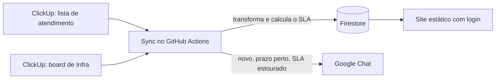

# painel-incidentes

Painel de acompanhamento de incidentes e SLA por cliente, sincronizado com o ClickUp.
Fiz para o time de suporte da empresa onde trabalho, e ele está em uso desde julho de 2026.
Esta é a versão pública: o código é o mesmo, sem
dados pessoais, sem configuração de infraestrutura e com um modo demonstração.

**Demo:** https://linykercs.github.io/painel-incidentes/ (dados fictícios, sem login)

## O problema

O contrato com os clientes cobra prazo de resolução por severidade (S1 em 8 horas úteis, S2
em 16, S3 em 24, S4 em 5 dias úteis), e a prova de cumprimento era montada à mão, em
planilha, uma vez por semana. Os reportes viviam em duas listas do ClickUp: a de atendimento,
onde o suporte registra a demanda, e o board de Infra, onde ficam o diagnóstico e a correção.
Nenhuma das duas sozinha contava a história inteira.

## Como funciona



1. **Sync** (`sync/`). Um job no GitHub Actions lê as duas listas pela API do ClickUp,
   filtra os cards de cada cliente e converte cada um num documento com tipo, severidade,
   data do reporte, prazo e status. Card apagado ou que deixou de se encaixar no filtro sai
   do painel na rodada seguinte.
2. **SLA** (`sync/sla.js`). O prazo conta só horas úteis: segunda a sexta, das 8h às 18h de
   Brasília. Reporte feito fora da janela começa a contar no próximo momento útil.
3. **Alertas** (`sync/chat.js`). Cada reporte novo, prazo a menos de 4 horas e SLA estourado
   vira uma mensagem num espaço do Google Chat, uma vez só por evento.
4. **Tradução** (`sync/translate.js`). Os clientes de fora do Brasil leem em espanhol. Os
   títulos são traduzidos de graça pela API do MyMemory, com cache e um glossário para os
   termos que o tradutor errava.
5. **Painel** (`site/`). HTML, CSS e JavaScript sem framework. Mostra KPIs, cumprimento do
   SLA por severidade, a tabela do mês, uma aba de desenvolvimentos para o time interno e um
   botão de PDF que imprime a visão do mês para o relatório semanal.

## Decisões

- **Custo zero.** Firebase no plano gratuito (Hosting, Auth e Firestore) e GitHub Actions. O
  painel serve vários clientes sem custo de infraestrutura.
- **SLA por severidade, não numa média.** Misturar S1 (8h) com S4 (50h) num número só
  esconde exatamente o que o contrato cobra, então o painel mostra cada faixa separada.
- **Um endereço por cliente.** Todos os sites servem os mesmos arquivos, e o domínio pelo
  qual a página abre decide quais clientes existem nela (`site/clients.js`). Quem abre o
  painel de um cliente não cai no de outro nem por engano.
- **A segurança está no servidor.** As regras do Firestore (`firestore.rules`) decidem quem
  lê cada cliente: e-mail do domínio do cliente, ou e-mail numa allowlist. O que o
  JavaScript da página faz é só montar a tela.
- **Severidade inferida, e marcada como inferida.** O board de Infra não tem a severidade do
  contrato, só a prioridade de desenvolvimento. O sync converte uma na outra e o painel
  avisa quando a severidade foi inferida.
- **Horário quebrado no agendamento.** O cron do GitHub Actions é best-effort, e `:00` e
  `:30` são os horários mais disputados. Com `*/30` os disparos chegaram a sair de 5 em 5
  horas; rodando em `:07` e `:37` normalizou.

## Rodar localmente

```bash
npm install
npm test               # 102 testes: SLA, transformações, clientes e filtros
node scripts/gerar-demo.js   # regenera os dados fictícios do modo demo
npx serve site         # abre o painel em modo demonstração
```

Com `site/config.js` preenchido com a config de um projeto Firebase, o painel passa a pedir
login e a ler do Firestore. O sync precisa de `CLICKUP_TOKEN` e `FIREBASE_SERVICE_ACCOUNT`
(e, opcionalmente, `GCHAT_WEBHOOK`) no ambiente: `npm run sync`. Os IDs das listas do
ClickUp e os rótulos de cada cliente ficam em `sync/clients.js`; na versão pública eles
aparecem como marcadores (`ID_BOARD_INFRA`, etc.).

## O que mudou da versão interna

- Nomes de pessoas, e-mails e logos de clientes foram retirados. Nomes nos testes são
  fictícios.
- IDs das listas do ClickUp, config do Firebase e endereços dos sites viraram marcadores.
- O sync é só manual (`workflow_dispatch`), porque sem os secrets não há o que ler.
- O modo demonstração (`site/demo-data.js`, gerado por `scripts/gerar-demo.js`) é exclusivo
  daqui. Os prazos dos dados fictícios usam a mesma regra de SLA do sync.

## Stack

JavaScript (Node 20, ES modules), Firebase (Auth, Firestore, Hosting), firebase-admin,
GitHub Actions, API do ClickUp, Google Chat webhooks, `node:test`.
